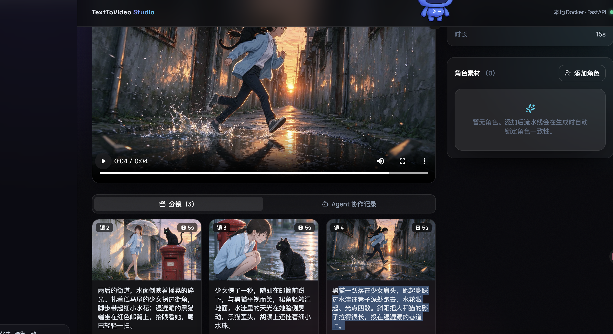
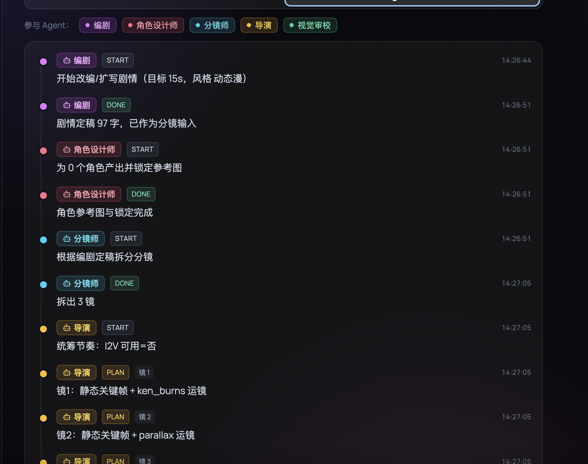
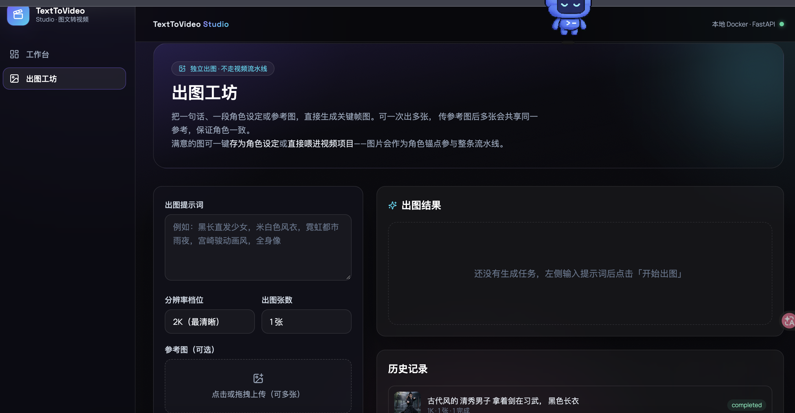
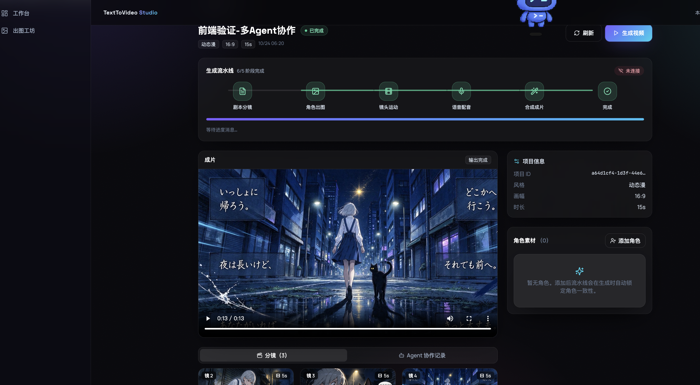

# 图文 / 小说 → 动态漫 Agent（后端）

个人用的「图文/小说转动态漫视频」后端：把小说/图文拆成角色一致的分镜，出关键帧图，做镜头运动，配音，合成 15 秒动态漫成片。Web 应用 + Python（FastAPI），本地 Docker 部署，跨集角色一致（云角色锁定），免费额度优先。

> 当前阶段：**后端已完成可运行骨架（MVP 单镜闭环）

## 架构

```
前端(待建) → FastAPI(/api/v1 + /ws) → 编排层(run_pipeline) → Celery Workers
                                                              ├─ LLM 分镜
                                                              ├─ 云角色出图(即梦/可灵/火山/mock)
                                                              ├─ FFmpeg 镜头运动
                                                              ├─ TTS 配音(Edge-TTS)
                                                              └─ FFmpeg 合成
                                  SQLite + 本地 media/ 目录（Docker 卷持久化）
```

默认 `DEFAULT_PROVIDER=mock`：**无需任何 API Key 即可跑通整条流水线**（占位出图 + 静音/Edge 配音）。配置真实 Key 后切换云 provider，跨集角色一致由云「角色锁定」保证。
## 页面效果
##### 页面显示








## 目录

```
backend/
├── app/
│   ├── main.py            # FastAPI 入口
│   ├── config.py          # pydantic-settings 配置
│   ├── database.py        # SQLAlchemy 引擎/会话
│   ├── models.py          # 6 张表（projects/characters/storyboards/assets/tasks/settings）
│   ├── schemas.py         # Pydantic 请求/响应
│   ├── orchestrator.py    # MVP 单镜闭环编排
│   ├── celery_app.py      # Celery 包装
│   ├── realtime.py        # WebSocket 进度 pub/sub
│   ├── services/          # provider / tts / ffmpeg / llm
│   └── api/v1/            # projects / characters / tasks / progress(WS)
├── requirements.txt
├── Dockerfile
└── tests/test_smoke.py
docker-compose.yml         # 本地 Docker：web + worker + redis
```

## 快速开始

### 方式 A：本地直接运行（无需 Docker / Redis）

```bash
cd backend
python -m venv .venv && source .venv/bin/activate
pip install -r requirements.txt
cp .env.example .env            # 默认 mock，无需 Key
# 确保系统已装 ffmpeg：brew install ffmpeg (Mac) / apt install ffmpeg (Ubuntu)
uvicorn app.main:app --reload --port 8000
```

### 方式 B：Docker Compose（推荐，含 worker + redis）

```bash
docker compose up --build
# 启用 Celery 异步：CELERY_ENABLED=true docker compose up --build
```

访问 `http://localhost:8000/docs` 查看交互式 API 文档。

## 跑通一次 MVP（15 秒动态漫）

```bash
# 1. 创建项目
curl -X POST http://localhost:8000/api/v1/projects \
  -H 'Content-Type: application/json' \
  -d '{"title":"测试","raw_input":"雨夜，少女撑伞而立，轻声说：该回家了。","target_duration":15}'
# 返回 { "id": "PROJECT_ID", ... }

# 2. 添加角色（有图上传 file；无图则 need_ai_image=true 让流水线 AI 出图再锁角色）
curl -X POST http://localhost:8000/api/v1/projects/PROJECT_ID/characters \
  -F 'name=少女' -F 'need_ai_image=true'

# 3. 触发生成（默认走 BackgroundTasks / Celery）
curl -X POST http://localhost:8000/api/v1/projects/PROJECT_ID/generate \
  -H 'Content-Type: application/json' \
  -d '{"provider":"mock","tts_engine":"edge","do_i2v":false,"camera":"ken_burns"}'

# 4. 查看进度（WebSocket）：ws://localhost:8000/api/v1/ws/projects/PROJECT_ID/progress
# 5. 成片：backend/media/<PROJECT_ID>/final_<PROJECT_ID>.mp4
```

## 配置真实云服务（可选）

在 `.env` 填入 Key 并改 `DEFAULT_PROVIDER`：
- **即梦/火山 Seedance**：`JIMENG_API_KEY` / `VOLC_API_KEY`（火山 mini 有免费额度）
- **可灵 Kling**：`KLING_API_KEY`（主体库做跨集一致）
- **LLM 分镜**：`LLM_API_KEY` + `LLM_BASE_URL`（DeepSeek/通义/GPT 兼容 OpenAI 协议）

> ⚠️ `app/services/cloud_providers.py` 中的即梦/可灵/火山适配器给出了调用流程，但**响应字段需对照官方 API 联调验证**（不同模型返回结构不同）。未配 Key 时自动回退 mock。

## 测试

```bash
cd backend && pip install -r requirements.txt && pytest
```

## 已知边界 / 下一步

- 真实云 provider 适配器待联调；当前 mock 出图为占位图。
- 口型（对口型）未做，MVP 为旁白/对白配音 + 嘴不动。
- 1 分钟多镜拼接逻辑已留接口（`ffmpeg.concat`），待扩展分镜数量。
